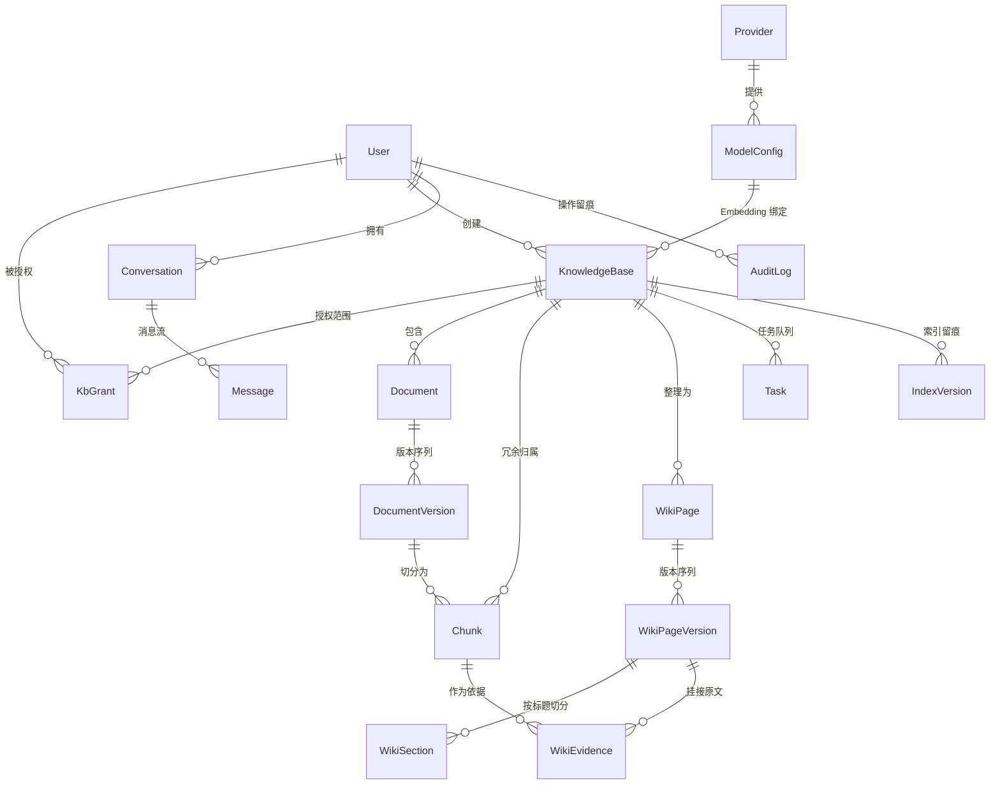

# 基于大语言模型的文档整理与问答系统 — 系统设计说明

本文的参数字段名、函数名与数字均取自当前仓库代码或实测输出；未能实测的一律标注「待实测」。

---

## 1. 总体架构

### 1.1 三层形态

系统是 Windows 桌面程序，而非 Web 服务：

| 层 | 实现 | 职责 |
| --- | --- | --- |
| 外壳 | Electron 33（`frontend/electron/main.cjs`） | 窗口、菜单、日志、sidecar 生命周期 |
| 服务 | Python 3.13 + FastAPI + Uvicorn（`backend/app/desktop_entry.py`） | HTTP API、检索、生成、后台任务 |
| 存储 | SQLite 单文件 + 本地文件目录 | 全部业务数据与原始文档 |

后端不是独立部署的服务，而是被 Electron 主进程以子进程方式拉起的 **sidecar**。`resolveBackendCommand()` 在打包环境下指向 `resources/backend/wrk-backend.exe`（PyInstaller `--onefile` 产物，实测 56,641,083 字节），开发环境回落到 `.venv/Scripts/python.exe -m app.desktop_entry`。

### 1.2 为什么不做微服务、为什么单机

目标场景是单个企业内部几十到几百人的知识检索，不是多租户 SaaS。微服务带来的三样东西在这里都是纯成本：服务发现与网关（只有一个后端进程）、独立数据库（数据量在单机 SQLite 可承受范围内，`demo_data` 三库仅 25 个检索单元，700 行表格文档也只产出 41 个分块）、以及运维（没有专职运维，双击图标就要能用）。

`db.py` 用 `PRAGMA journal_mode=WAL` + `busy_timeout=15000` 支撑「HTTP 请求线程 + 2 个 Worker 线程」（`WORKER_CONCURRENCY = 2`）的并发写，而不引入外部队列。三个约束进一步把部署方式钉死在单机：

1. **数据不出企业**。`config.HTTP_TRUST_ENV` 默认 `0`，注释写明「企业内网部署不应把 API Key 意外送进系统代理」。文档原文、分块、向量全部落在本机 `AppData`。
2. **零配置可用**。未配置模型时，`llm.embed()` 回落到 `hash_embed()`（`FALLBACK_EMBED_DIM = 256`），`answering.answer()` 回落到 `_extractive_answer()` 抽取式回答。
3. **安装即部署**。`WRK_DATA_DIR`、`WRK_DB_PATH`、`WRK_SECRET_DIR` 都指向 `app.getPath('userData')` 之下，卸载重装不丢数据。

### 1.3 sidecar 生命周期

**动态端口**。`_pick_port()` 先试 `WRK_PORT` 指定端口，被占用则 `bind((host, 0))` 让系统分配；`main.cjs` 默认传 `WRK_PORT=0`，解决多实例共存与端口冲突。

**WRK_READY 握手**。`announce()` 线程轮询最多 600 × 50 ms，等 `server.started` 或 `_port_open()` 成功后向 stdout 打印一行 `WRK_READY {"host","port","version","app","pid"}`。`main.cjs` 的 `onData` 按行切分 stdout，用 `/^WRK_READY (\{.*\})$/` 匹配后 `resolve(backendInfo)`，渲染进程通过 `ipcMain.handle('wrk:info')` 拿到 `apiBase`；60 秒未就绪则 reject 并弹窗。两个坑已写进注释：打包必须 `--console`（`--windowed` 下 stdout 为空，握手永远等不到）；`announce()` 不能只查 `server.started`，它在 lifespan 完成后才置位，而端口 bind 更早。

**stdin EOF 自退**。`watch_stdin()` 阻塞读 `sys.stdin.readline()`，父进程退出时管道关闭返回空串，触发 `server.should_exit = True`。这比信号可靠——Windows 上 Electron 被强杀时子进程收不到 SIGTERM。`stopBackend()` 是双保险：先 `stdin.end()` + `SIGTERM`，4 秒后 `SIGKILL`。

---

## 2. 数据模型



核心字段：`Chunk` 有 `text / heading / locator / keywords / vector_blob / embed_signature / kind / meta`，其中 `meta` 存表格的 `{row_start,row_end,total_rows,cols,caption,part,parts}`；`WikiPage` 有 `slug / status / current_version_id / human_locked`；`Task` 有 `kind / status / stage / progress / attempts / dedupe_key`；`Message` 有 `evidence / route / latency_ms`。

### 2.1 几处刻意的冗余与约束

**`Chunk.kb_id` 冗余**。理论上可由 `doc_id` 推出库，但单库检索是最高频操作，`_chunk_rows()` 直接 `where(Chunk.kb_id == kb_id)` 一次取全，不必 join。索引 `ix_chunk_kb_version` 建在 `(kb_id, doc_version_id)` 上，同时服务「按库取候选」与「按版本下线旧块」。

**`Chunk.kind` + `meta`**。让表格证据能定位到「表格 1 第 685-700 行」而不只是「某个表格」。这两列是后期新增的，因此需要第 4 节的补列机制。

**`Message.evidence` / `route` 是快照不是引用**。回答当时命中哪些块、走 wiki 还是 chunk、是否 fallback，全部序列化进消息行。文档更新、索引重建、权限变更后，历史会话仍能还原「当时看到了什么」。

**`IndexVersion` 目前只写不读**。`ingest.py` 与 `wiki.py` 共三处 `db.add(IndexVersion(...))`，但全项目无任何查询使用它。它记录 `kind / embed_signature / unit_count`，当前仅作留痕，不参与检索决策，也不支持回滚。论文中宜写「索引构建留痕」而非「索引版本管理」。

---

## 3. 双形态索引

同一知识库有两种可检索形态，由 `KnowledgeBase.mode` 选择，运行时可回退。

| 维度 | 基础分块（`basic`） | Wiki 增强（`wiki`） |
| --- | --- | --- |
| 索引单元 | `Chunk` | `WikiSection`（回退时用 `Chunk`） |
| 单元来源 | 原文 → `split_blocks()` | 页面正文 → `split_markdown()` |
| 单元长度 | 26–1560 字符（实测区间） | 134–411 字符（`员工手册.md` 实测 7 节） |
| 组织结构 | 扁平，靠 `heading` 字符串关联 | 两层：`WikiPage` → `WikiSection`，`heading_path` 带页面名 |
| 生成成本 | 一次解析 + 一次向量化 | 主题归纳 + 每主题页面生成 + 章节向量化 |
| 可读性 | 原文片段，需自行拼接 | 已成文，可直接阅读校对 |
| 更新代价 | 单文档增量 | 全库重建（`rebuild_wiki` 任务） |
| 证据链 | 直接指向原文 | 经 `WikiEvidence` 转一层回原文 |

**适用场景**。原文结构清晰、以查阅为主（制度条款、操作手册、参数表）用 `basic`——用户要的是「哪一条怎么写的」，二次归纳反而增加失真风险。原文零散、需跨文档合并同一主题（同一流程散落在多个文件多处）用 `wiki`——价值在「整理」，把散落信息收拢成一页。

**成本量级**。`wiki` 模式对同一批内容要多付：一次主题归纳调用（`TOPIC_PROMPT`，输入被 `context[:9000]` 截断）、每个主题一次页面生成（`PAGE_PROMPT`，`max_tokens=1400`）、以及全部章节向量化。`MAX_TOPICS = 12`，页面生成调用最多 12 次。离线降级时三类调用全部归零——实测 `员工手册.md`（8 chunks）的 `CallStats` 是 `calls=0, prompt_tokens=0, completion_tokens=0, mode='offline'`，`WikiBuildResult(pages_created=7, sections=7, evidence_links=8)`。

成本由 `CostRecord` 表按阶段留痕，`GET /api/kbs/{id}/cost` 聚合出 `by_group.ingest` 与 `by_group.wiki` 两列——这正是「索引成本」与「整理成本」的分界。`CallStats` 把 `chat_calls` 与 `embed_calls` 分开记，因为二者计费口径不同（生成按输入/输出分别计价，向量通常只按输入计价且单价常低一个数量级）；`live_calls` 与 `offline_calls` 也分开，离线哈希向量不产生费用但确实是一次操作。

---

## 4. 文档处理流水线

### 4.1 主链路

```
上传 → 校验 → 落盘存版本 → 建 Task(queued) → Worker 认领
     → 解析 parse_document() → 分块 split_blocks()
     → 向量化 llm.embed() → 写 Chunk → 下线旧版本块
     → 刷新库状态 → [wiki 模式] build_wiki()
```

**上传与校验**。`ALLOWED_SUFFIXES` 限定 8 种：`.txt .md .markdown .log .pdf .docx .xlsx .pptx`，`MAX_UPLOAD_MB = 50`。解析层还实现了 `.csv`、`.json`（`PLAIN_SUFFIXES`）与 `.html`、`.htm`（`HTML_SUFFIXES`），但不在上传白名单内，正常上传路径不可达。

**版本落盘**。每次上传生成新 `DocumentVersion`，`storage_path` 指向 `FILES_DIR` 下实际文件，`version_no` 在 `(doc_id, version_no)` 唯一约束下递增。原文件保留，可回取任意历史版本。

**任务队列**。`Task` 表即队列。`worker._claim()` 用条件更新抢占：`update(Task).where(Task.id == task.id, Task.status == "queued").values(status="running", ...)`，`rowcount != 1` 即放弃，两个线程不会重复执行。`dedupe_key` 防同类任务堆积。`ingest._set_progress()` 在 10/35/55/80/88 五个阶段写 `stage` 与 `progress`，前端 2 秒轮询 `GET /api/tasks`。

### 4.2 失败处理

失败分三级，粒度必须区分：

| 级别 | 字段 | 语义 |
| --- | --- | --- |
| 任务 | `Task.status = failed`、`Task.error` | 本次执行失败，可 `POST /api/tasks/{id}/retry` |
| 文档版本 | `DocumentVersion.status = failed` | 这个版本没进来 |
| 知识库 | `KnowledgeBase.status` | **取决于库里还有没有可用索引单元** |

第三级最容易写错。`worker.py` 的失败分支先统计剩余分块，`remaining` 非空则置 `partial`（附「仍有 N 个索引单元可用」），为空才置 `failed`。理由就是下一条幂等规则：旧版本分块在新版本失败时是**保留**的，检索仍能命中。若无条件置 `failed`，界面会告诉用户「这个库坏了」，而实际上它完全可用。Wiki 生成失败单独处理：`ingest_version()` 捕获异常后 `db.rollback()`，只把 `kb.status` 置 `partial` 并写 `wiki_error`，**不推翻已建好的分块索引**——Wiki 是增强，不是前置依赖。

### 4.3 幂等

**同一版本重跑**。`ingest_version()` 写新块前先 `delete(Chunk).where(Chunk.doc_version_id == version.id)`，重跑不累积重复块。

**「新版本成功入库后才下线旧版本分块」**。这是整条流水线最关键的顺序约束。代码在写完新块、`db.flush()` 之后才执行 `delete(Chunk).where(Chunk.doc_id == doc.id, Chunk.doc_version_id != version.id)`。若把下线放到解析之前，一旦新版本解析失败，用户会同时失去新旧两份索引——库从「可用」直接变成「空」。当前顺序的代价是失败时库里短暂存在两个版本的分块，但 `Document.current_version_id` 只在成功路径更新，检索仍以旧版本为主。

**Wiki 幂等**。`build_wiki()` 按 `slug` 查页面，存在则复用并递增 `version_no`，不产生重复页。

### 4.4 老库缺列自愈

`init_db()` 在 `create_all()` 之后调用 `ensure_sqlite_columns(engine, Base.metadata)`。原因是 SQLAlchemy 的 `create_all` **只建缺失的表，不给已存在的表加列**。桌面版升级后，用户 `AppData` 里的老库缺少后来新增的列（典型如 `chunks.kind`、`chunks.meta`），任何查询都会 `OperationalError: no such column`，接口直接 500。

实现上三处保守取舍：只处理「加列」，改类型、加约束、删列等破坏性变更不自动做（宁可启动报错让人工迁移，也不静默改坏数据）；按 SQLite 的 `ADD COLUMN` 限制生成 DDL（不能 UNIQUE、不能非空无默认值、默认值不能是表达式），`callable` 默认值如 `default=utcnow` 直接丢弃交给运行时；单列失败只 `log.warning` 不中断，返回实际补上的 `"表.列"` 列表供测试断言。

---

## 5. 分块策略

分块是检索质量的上游。文本走 `split_blocks()`，表格走 `split_table()`，两条独立路径。

### 5.1 文本块

**标题变化强制切分**。遇到 `kind == "heading"` 的解析块，或段落 `block.heading` 与当前 `heading` 不同，立即 `flush(carry_overlap=False)` 并切换标题。若不切，「考勤」和「请假」会被并进同一块，命中后无法判断属于哪一节，Wiki 主题归纳也会串主题。

**overlap 只在同标题内生效**。`flush(carry_overlap=True)` 只出现在一处：同一标题内段落聚合溢出 `size` 时。其余 5 处（heading 边界、table 边界、image 边界、超长段前、函数末尾）全部传 `False`。换标题时带 overlap 会把上一节内容混进新章节。

**超长段落按句切分**。`len(text) > size * 1.6`（1120 字符）时用 `_SENT_SPLIT` 按 `。！？!?；;` 断句，累积到 `size` 就 emit。「回退 1 句」而非「回退 N 字符」，因为中文句子长度差异大，按字符回退容易把句子切成两半。

**`DEFAULT_CHUNK_OVERLAP = 120` 的实测口径**。参数有默认值，但行为与名字不完全一致：

- `split_blocks()` 里 `overlap = overlap or config.DEFAULT_CHUNK_OVERLAP`，**传 `overlap=0` 会被替换成 120**，无法通过参数关掉重叠。
- 把 `config.DEFAULT_CHUNK_OVERLAP` 改成 0 再以 `overlap=None` 调用，段落聚合路径确实变成无重叠（实测块长 `[635, 635]`，第二块以 `SEG07` 开头）；保持 120 时块长 `[635, 650, 226]`，第二块以重叠尾部开头——**120 字符重叠在这条路径上生效**。
- 超长段落分支用 `acc = acc[-1:]`，回退 1 句而非 120 字符。实测该路径 `overlap=0` 与 `120` 的块数、块长一致，差别只在第二块是否从上一块最后一句开始。
- 标题切换路径恒为 0 重叠（实测「章节甲」400 字 + 「章节乙」400 字，两块各自独立无交叉）。

准确表述：**同一标题内段落聚合溢出时保留 120 字符尾部重叠；超长段落按句切分时回退 1 句；标题/表格/图片边界处不重叠**。

### 5.2 表格块：为什么两种极端都不行

`demo_data/fixtures/` 提供三份真实规模的表，实测三种策略：

| 文件 | 规模 | 逐行切分 | 整表一块 | 行组 + 表头重复（现实现） |
| --- | --- | --- | --- | --- |
| `员工薪酬明细_120行.docx` | 120 行 × 9 列 | 120 块，均长 83.9 | 1 块 / 10,201 字符（正文预算 14.6×） | **7 块**，1055–1558 字符，12–18 行/块，均 17.1 行 |
| `员工薪酬明细_700行.docx` | 700 行 × 9 列 | 700 块，均长 83.8 | 1 块 / 59,403 字符（正文预算 84.9×） | **39 块**，1385–1560 字符，16–18 行/块，均 17.9 行 |
| `员工薪酬明细_200行.xlsx` | 200 行 × 9 列 + 6 行 × 4 列 | 206 块 | 1 块 / 16,979 字符（正文预算 24.3×） | **13 块**（12 + 1），193–1564 字符 |

**逐行拆为什么不行**：一行是「工号: E0231；姓名: 王五；部门: 销售部；岗位: 客户经理；月薪: 18500」。用户问「销售部客户经理的薪酬范围」，命中的那行只给了一个人的月薪，回答不了「范围」，而检索只返回 top-k 条。且 83 字符里大半是重复列名与格式化数字，语义信号被结构性噪声淹没——700 行产生 700 个高度相似的向量，检索几乎无法区分。成本上，700 块要 44 批向量化（`batch = 16`），按行组只需 3 批。

**整表一块为什么不行**。59,403 字符远超任何主流 embedding 的输入窗口。模型侧截断是**静默**的——不报错、不返回标记，只是块尾数据没进向量。结果是索引里只有前若干行，用户查第 600 行的工号永远查不到，系统也不会说明原因。碎块只是效果差，截断是数据丢失且不可观测。

**行组 + 表头重复的做法**。`render()` 给每块加头部 `表：表格 1（共 700 行），本段为第 685-700 行`，并重复列名，保证块自身可读、可独立检索、不依赖相邻块。`locator` 写成 `表格 1 第 685-700 行`，`meta` 记录行区间与 `part/parts`，证据能精确定位回原始行。实测 39 块的行区间拼起来正好 1..700，连续无重叠无遗漏。

### 5.3 字符预算是硬约束，行数是软目标

`split_table()` 注释把这条写死：**字符预算是硬约束，行数是软目标**。`budget = max(TABLE_CHUNK_BUDGET - header_overhead, 200)`，装行时只要 `cur_len + line_len > budget` 就立即封组。不让行数做主导的理由：超预算会被 embedding 静默截断，截断后块尾数据不在索引里且无任何信号，宁可切碎也不能超；表格单行长度方差极大，同为 9 列，短行 84 字符，长行（地址、备注写满）可到几百字符，按固定行数切会让短行组浪费预算、长行组直接溢出；下限行数只是防过度碎片化，实现方式是「先装满再封组」，自然形成 16–18 行的稳定分组。

`TABLE_CHUNK_BUDGET = 1600` 比正文 `DEFAULT_CHUNK_SIZE = 700` 大一倍多，理由是表格信息密度高，1600 字符远未触及主流 embedding 的 512–8192 token 窗口。**已知限制**：单行单元格内容 > 1600 字符时该行仍会超预算——当前视「行」为原子单位，拆行会破坏行内字段对应关系，需产品决策。

---

## 6. 检索与融合

代码里是两套完全不同的融合逻辑，必须分两层写。

### 6.1 第一层：库内 —— 加权 RRF

单库内部，`search_chunks()` 与 `search_wiki()` 各跑两个通道再合并：`keyword_rank()` 产出 `kw_ids`，`vector_rank()` 产出 `vec_ids`，最后由 `rrf_fuse([kw_ids, vec_ids], weights=channel_weights(...))` 融合。

`rrf_fuse()` 的标准形式为 `scores[rid] += w / (k + rank)`，`k = RRF_K = 60`。`weights` 由 `channel_weights()` 给出：关键词通道恒 1.0；向量通道在**离线哈希向量**下压到 0.45，接入真实 embedding 后回到 1.0。理由是离线哈希向量只保证链路可跑通，排序质量明显弱于关键词，等权会把关键词的正确排序冲掉。

**为什么不比较原始分数**。关键词分是 BM25 变体的加权和，量纲随 `idf`、`tf`、文档长度浮动，可到几十分；余弦相似度是 −1 到 1 的有界量。直接相加或加权平均没有意义——权重会随语料规模漂移，换个库就得重调。RRF 只用**名次**，天然消除量纲差异，代价是丢失「差多少」的信息。

**关键词通道的真实行为**（不要引用 `bm25_score()`，它是死代码，全项目零调用）。`keyword_rank()` 内联了一套 tf/idf：`idf = log(1 + (n_docs - df + 0.5) / (df + 0.5))`，`df` 与 `avg_len` 均按当前候选语料实时计算；`k1 = 1.4`、`b = 0.72` 硬编码；命中 `keywords` 字段 ×1.8（该字段是 `extract_keywords()` 抽过的主题词）；命中 `heading` +0.9；覆盖率加成 `× (1 + 0.18 × (hits - 1))`；入选门槛 `hits >= 2` 或存在长度 ≥ 3 的查询词命中，门槛过严导致零结果时回退到「原始命中 + `log1p(tf)`」的宽松打分。

**向量通道的词汇闸门**。`vector_rank()` 的 `lexical_ids` 参数要求向量结果与关键词结果有交集才保留，交集为空则放行全部（当作同义改写）。注释写明理由是「纯语义召回在没有真实 embedding 时噪声极大，会把无关条目顶上首位」。阈值也不固定：`cutoff = max(min_sim, best * rel_ratio)`，`rel_ratio = 0.55`、`min_sim = 0.05`。用相对最高分的比例做主判据，因为不同模型的相似度分布差异很大，固定绝对阈值必然在某一类模型上失效。

### 6.2 第二层：跨库 —— 覆盖率 × 名次衰减

`retrieve()` 拿到每库 top-N（`PER_KB_CANDIDATES = 8`）后**不使用 RRF**，而是：

```python
coverage  = 命中查询词数 / 查询词总数          # 0~1，绝对量
rank_term = 1.0 / (1.0 + 0.45 * local_idx)     # 库内名次衰减
balance   = 1.0 if local_idx == 0 else 1.0 / (1.0 + 0.10 * kb_idx)
score     = (0.25 + coverage) * rank_term * balance
```

三个分量：`0.25 + coverage` 是跨库唯一可比的量，它是 0~1 的绝对比例，与检索方式、库大小、通道权重无关；`rank_term` 是库内名次衰减，`local_idx=0` 时 1.0、`=1` 时 0.690、`=2` 时 0.526，库内名次已由加权 RRF 决定，跨库只做粗排；`balance` 是库间均衡因子，只作用于库内第 2 名之后，各库首位候选平等竞争。排序后 `coverage > 0` 的候选在前，为 0 的接在后面，不占名额也不丢弃。

**必须记住的副作用**：`coverage` 与最终 `rank` 不是单调关系。实测查询「P0 工单首次响应时限」，rank 1 是 coverage 0.38 的正文段落，rank 2 是 coverage 0.62 的工单分级表格——两者同属客户支持库，`rank_term` 的 1.0 vs 0.690 压过了 `(0.25+coverage)` 的 0.63 vs 0.87。做实验时「证据覆盖率」与「检索名次」必须作为两个层次分别统计。

**`coverage` 已对外输出**。`Evidence.to_dict()` 含 `"coverage": round(self.coverage, 4)`，`/api/search/preview` 的 `evidence[]` 能直接读到；`stats["query_terms"]` 给出本次使用的查询词（截前 16 个）。**`top_k` 有下限**：`total = MAX_EVIDENCE if top_k is None else max(top_k, 3)`，传 `top_k=1` 实际返回 3 条；`top_k` 同时被用作每库候选数，两个语义复用一个参数。

---

## 7. 自动路由

路由解决「配置了 wiki 模式 ≠ Wiki 现在能用」。`plan_route()` 返回 `(used, reason, fallback)`：

```python
if kb.mode == "wiki":
    if 存在已发布且有 current_version_id 的 WikiPage:
        return "wiki", "Wiki 已就绪，检索 Wiki 章节", False
    if 存在任意 Chunk:
        return "chunk", "Wiki 尚未生成完成，已回退到分块索引", True
    return "none", "Wiki 未就绪且没有可用分块索引，该库暂不可检索", True
if 存在任意 Chunk:
    return "chunk", "基础分块库，关键词 + 语义检索后 RRF 融合", False
return "none", "知识库还没有可检索的文档", False
```

**逐库独立判定**。`retrieve()` 对每个库单独调 `plan_route()`，不是全局一刀切。多库混合时完全可能 A 库走 wiki、B 库走 chunk、C 库不可用，`KbRoute` 逐条记录。

**Wiki 未就绪回退分块并标 fallback**。回退不静默：`route.used` 改成 `"chunk"`，`reason` 追加说明，`fallback = True`。前端路由面板显示标记，`answering._insufficient_text()` 在证据不足时也会列出「以下知识库发生了检索方式回退」。还有一条二次回退：`used == "wiki"` 但 `search_wiki()` 返回空时再试 `search_chunks()`，命中则改用分块并置 `fallback = True`，覆盖「Wiki 已就绪但与本次查询无关」。

**`wiki_ready` 有三个口径，当前不一致**。`serializers.kb_out()` 按「已发布且 `current_version_id` 非空的 WikiPage 数 > 0」；`routers/kbs.py:_index_status()` 按「`WikiSection` 数 > 0」；`plan_route()` 用第一种。页面已发布但章节切不出来（正文不足 8 字符）时前两者结论相反。当前以 `plan_route()` 为准，另两处只影响展示。

---

## 8. 证据链

目标是从回答的任意一句追到原文具体位置：

```
Message.content          回答正文，结论后带 [编号]
  → Message.evidence[]   本轮实际使用的证据快照（JSON）
    → Evidence.key       "chunk:{chunk_id}" 或 "wiki:{page_version_id}:{heading}"
      → Chunk.locator    "第 3 页" / "表格 1 第 685-700 行" / "表格 1 全表"
      → WikiEvidence     wiki 证据经此回挂原文：chunk_id + quote + locator
```

**引用编号校验**。`_citation_check()` 用 `\[(\d{1,2})\]` 抽取回答里的编号，与证据列表长度比对，返回 `{cited, invalid, citation_ok}`。`invalid` 非空说明模型编了不存在的编号——可观测的幻觉信号。

**`insufficient` 的判定边界**。判定式是 `(not citations["cited"]) and any(m in text for m in REFUSAL_MARKERS)`。注意是 `and`：**只要模型带了任意合法引用编号就不会判 insufficient**，哪怕它同时在说「资料不足」。所以「无答案题」的正确率必须人工判定，不能只读这个字段。

**证据不足时的可解释性**。`_insufficient_text()` 不是一句「不知道」，而是分两段列出：哪些库当前不可检索（`used == "none"`）及原因，哪些库发生了检索方式回退。用户能据此判断是「确实没有资料」还是「资料在但索引有问题」。离线时 `_extractive_answer()` 从证据里按查询词命中数挑句子，每句后仍标 `[编号]`，证据链不降级。

---

## 9. 权限模型

**两级角色 + 库级授权**。`User.role` 是 `admin` / `employee`；`KbGrant.level` 是 `read` / `manage`。admin 隐式拥有全部知识库 `manage`（`grant_level()` 第一行直接返回）。`read` 可检索、提问、看来源；`manage` 额外可上传/删除文档、重建索引、校对 Wiki。

**每次实时校验，不用会话缓存**。`deps.grant_level()` 每次都执行 `select(KbGrant).where(kb_id, user_id)` 查库，注释写明「每次实时查库，撤销后旧会话立即失效」。令牌是无状态 JWT（`ACCESS_TOKEN_TTL_MINUTES = 720`），里面只有 `uid` 不含权限位，改权限不需等令牌过期，下一个请求就生效。

**提问时的库过滤是白名单不是黑名单**。`chat._allowed_kbs()` 遍历请求的 `kb_ids` 逐个判定，无权限的进 `denied` 并附原因（「没有该知识库的访问权限」），而不是静默丢弃。`ask` 与 `search/preview` 都在 `denied` 非空时把它带回响应，前端弹 toast。理由很实际：用户选了三个库只搜到两个库的结果，不告知就会误判「另一个库没有这条资料」。

**至少保留一个管理员**。`auth._ensure_admin_remains()` 在停用或降级管理员前统计其他活跃管理员，`count < 1` 时返回 400。`DELETE /api/users/{id}` 是软删除（置 `disabled`），且不能停用自己。`deps.audit()` 把 `user_id`、`username`、`action`、`target`、`detail` 写进 `AuditLog`，登录、建用户、改授权、重建索引、重试任务都留痕。

---

## 10. 更新与一致性

### 10.1 新版本下线旧索引

顺序约束已在 4.3 说明。补两个一致性细节：`Document.current_version_id` 只在成功路径更新，失败时仍指向旧版本，`search_chunks()` 取证据时按 `chunk.doc_version_id` 反查 `DocumentVersion` 拿 `version_no`，所以证据卡片显示的版本号与用户看到的「当前版本」一致；`doc.deleted` 的文档在检索结果里被跳过（`if doc and doc.deleted: continue`），删除文档时先置 `deleted`，分块随外键级联删除，Wiki 库额外触发 `rebuild_wiki`。

### 10.2 Wiki 人工校对保护

`WikiPage.human_locked` 是布尔标记。`PUT /api/kbs/{id}/wiki/pages/{slug}` 保存人工版本时置 `True`，`origin = "human"` 写进 `WikiPageVersion`。重建时 `build_wiki()` 遇到 `page.human_locked and not force` 的页面，把状态从 `published` 降为 `needs_review`，正文不动，`pages_skipped += 1` 并在 `notes` 里写「已人工校对，本次生成进入待审，不覆盖」；用户可选择 `POST .../unlock` 解除锁定。这条设计的价值在于：自动整理的质量不可能稳定高于人工校对，而重建是常态操作（每次文档入库都会触发）。没有锁定保护，任何一次上传都会把校对成果冲掉。

### 10.3 Embedding 切换强制全量重建

`kb.embed_signature` 记录「这个库的向量用哪个模型、多少维算出来」，格式如 `openai:text-embedding-3-small:1536`。检索时 `search_chunks()` 只取 `Chunk.embed_signature == kb.embed_signature` 的向量，这是硬隔离——新旧模型的维度与语义空间都不同，混用会让余弦相似度失去意义。切换必须全量重建，接口层设了闸门：`if has_index and not body.confirm: raise HTTPException(400, ...)`，确认后创建 `embedding_rebuild` 任务，逐库调 `ingest.reindex_kb()`，按 16 条一批重算全部向量。

**签名不一致时的降级行为**。`ingest_version()` 里若 `kb.embed_signature` 与当前配置不符，**仍按库内旧签名写入**（`sig = kb.embed_signature; dim = kb.embed_dim`），即「不允许在未重建时混用新模型向量」。代价是这段时间新文档用旧模型向量，收益是库内始终自洽；`GET /api/settings/embedding/status` 的 `signature_mismatch` 暴露该状态。

**离线哈希向量不算「真实模型」**。`active_embedding()` 在无配置时返回 `sig = "local-hash-embedding:256"`，`channel_weights()` 据此把向量通道压到 0.45。接入真实模型后签名变化，所有旧库都需要重建——这也是实验必须在「统一向量来源」下进行的原因。

---

## 附：本文数字的取证方式

| 数字 | 来源 |
| --- | --- |
| 700 行 → 39 块、1385–1560 字符、均 17.9 行；120 行 → 7 块；200 行 xlsx → 13 块 | `backend/scripts/inspect_chunks.py` 实跑 + 独立探针复算 |
| 整表 59,403 / 10,201 / 16,979 字符 | 探针按 `_row_to_line()` 逐行拼接复算 |
| `demo_data` 三库 25 个检索单元 | 探针跑 `parse_document` + `split_blocks` |
| Wiki 7 页 / 7 节 / 8 证据、`calls=0` | 探针灌临时 SQLite 跑 `build_wiki()` |
| 检索耗时 min 6.0 / P50 6.8 / max 14.3 ms | 9 条查询跑 `retrieve()`，离线哈希向量 |
| 测试基线 111 passed, 1 skipped | `pytest tests/ -q` |

检索耗时是**离线哈希向量 + 内存遍历**的端到端时间，不含网络往返。接入真实 embedding 后必须重测。