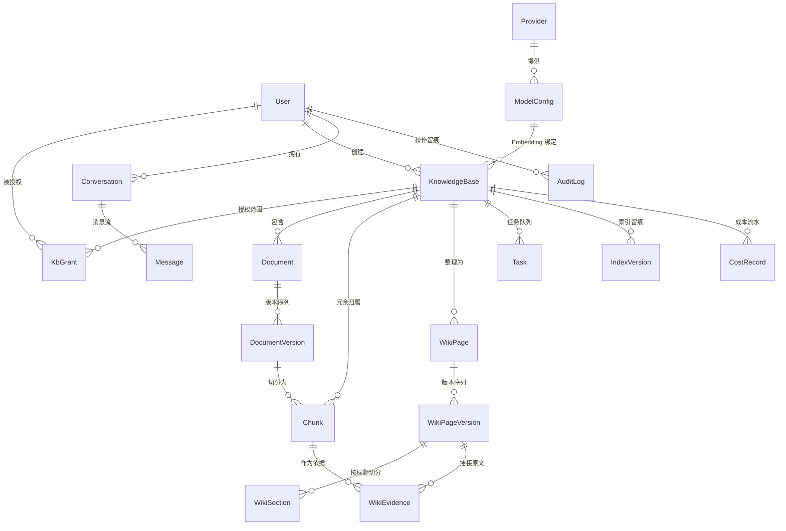

# 基于大语言模型的文档整理与问答系统 — 系统设计说明

本文的参数字段名、函数名与数字均取自当前仓库代码或实测输出；未能实测的一律标注「待实测」。

---

## 1. 总体架构

### 1.1 三层形态

系统是 Windows 桌面程序，而非 Web 服务：

| 层 | 实现 | 职责 |
| --- | --- | --- |
| 外壳 | Electron 33（`frontend/electron/main.cjs`） | 窗口、菜单、日志、sidecar 生命周期 |
| 服务 | Python 3.13 + FastAPI + Uvicorn（`backend/app/desktop_entry.py`） | HTTP API、检索、生成、后台任务 |
| 存储 | SQLite 单文件 + 本地文件目录 | 全部业务数据与原始文档 |

后端不是独立部署的服务，而是被 Electron 主进程以子进程方式拉起的 **sidecar**。`resolveBackendCommand()`（`main.cjs:139`）在打包环境下指向 `resources/backend/wrk-backend.exe`（PyInstaller `--onefile` 产物；体积随依赖版本变化，本文不固化字节数），开发环境回落到 `.venv/Scripts/python.exe -m app.desktop_entry`。

### 1.2 为什么不做微服务、为什么单机

目标场景是单个企业内部几十到几百人的知识检索，不是多租户 SaaS。微服务带来的三样东西在这里都是纯成本：服务发现与网关（只有一个后端进程）、独立数据库（数据量在单机 SQLite 可承受范围内，`seed_demo` 三库 25 个检索单元，`seed_expanded` 三库 55 个，700 行表格文档也只产出 41 个分块）、以及运维（没有专职运维，双击图标就要能用）。

`db.py` 用 `PRAGMA journal_mode=WAL` + `busy_timeout=15000` 支撑「HTTP 请求线程 + 2 个 Worker 线程」（`WORKER_CONCURRENCY = 2`）的并发写，而不引入外部队列。三个约束进一步把部署方式钉死在单机：

1. **数据不出企业**。`config.HTTP_TRUST_ENV` 默认 `0`，注释写明「企业内网部署不应把 API Key 意外送进系统代理」。文档原文、分块、向量全部落在本机 `AppData`。
2. **零配置可用**。未配置模型时，`llm.embed()` 回落到 `hash_embed()`（`FALLBACK_EMBED_DIM = 256`），`answering.answer()` 回落到 `_extractive_answer()` 抽取式回答。
3. **安装即部署**。`WRK_DATA_DIR`、`WRK_DB_PATH`、`WRK_SECRET_DIR` 都指向 `app.getPath('userData')` 之下，卸载重装不丢数据。

### 1.3 sidecar 生命周期

**动态端口**。`_pick_port()`（`desktop_entry.py:33`）先试 `WRK_PORT` 指定端口，被占用则 `bind((host, 0))` 让系统分配；`main.cjs` 默认传 `WRK_PORT=0`，解决多实例共存与端口冲突。

**WRK_READY 握手**。`announce()` 线程轮询最多 600 × 50 ms（`desktop_entry.py:62`），等 `server.started` 或 `_port_open()` 成功后向 stdout 打印一行 `WRK_READY {"host","port","version","app","pid"}`。`main.cjs` 的 `onData` 按行切分 stdout，用 `/^WRK_READY (\{.*\})$/` 匹配后 `resolve(backendInfo)`，渲染进程通过 `ipcMain.handle('wrk:info')` 拿到 `apiBase`；60 秒未就绪则 reject 并弹窗（`main.cjs:273`）。两个坑已写进注释：打包必须 `--console`（`--windowed` 下 stdout 为空，握手永远等不到）；`announce()` 不能只查 `server.started`，它在 lifespan 完成后才置位，而端口 bind 更早。

**stdin EOF 自退**。`watch_stdin()` 阻塞读 `sys.stdin.readline()`，父进程退出时管道关闭返回空串，触发 `server.should_exit = True`。这比信号可靠——Windows 上 Electron 被强杀时子进程收不到 SIGTERM。`stopBackend()` 是双保险：先 `stdin.end()` + `SIGTERM`，4 秒后 `SIGKILL`（`main.cjs:287`）。

---

## 2. 数据模型



核心字段：`Chunk` 有 `text / heading / locator / keywords / vector_blob / embed_signature / kind / meta`，其中 `meta` 存表格的 `{row_start,row_end,total_rows,cols,caption,part,parts}`；`WikiPage` 有 `slug / status / current_version_id / human_locked`；`Task` 有 `kind / status / stage / progress / attempts / dedupe_key`；`Message` 有 `evidence / route / latency_ms`；`CostRecord` 有 `kind / source / source_id / doc_id` 与三通道计数字段（见第 11 节）。

### 2.1 几处刻意的冗余与约束

**`Chunk.kb_id` 冗余**。理论上可由 `doc_id` 推出库，但单库检索是最高频操作，`_chunk_rows()` 直接 `where(Chunk.kb_id == kb_id)` 一次取全，不必 join。索引 `ix_chunk_kb_version` 建在 `(kb_id, doc_version_id)` 上，同时服务「按库取候选」与「按版本下线旧块」。

**`Chunk.kind` + `meta`**。让表格证据能定位到「表格 1 第 685-700 行」而不只是「某个表格」。这两列是后期新增的，因此需要第 4 节的补列机制。

**`Message.evidence` / `route` 是快照不是引用**。回答当时命中哪些块、走 wiki 还是 chunk、是否 fallback，全部序列化进消息行。文档更新、索引重建、权限变更后，历史会话仍能还原「当时看到了什么」。`chat.ask()` 把 `insufficient` / `usage` / `suggestions` / `refusal_reason` 一并塞进 `route` 快照（`chat.py:154-161`），刷新页面后不必重跑即可还原「当时是否证据不足」「花了多少调用」「当时建议问什么」；`serializers.message_out()` 再从 `route` 里读回并展开成顶层字段（`serializers.py:237-242`），老消息缺这两个键或数据损坏时退回 `[]` / `""`（`serializers.py:225-230`）。

**`IndexVersion` 目前只写不读**。`ingest.py:138`、`ingest.py:249`、`wiki.py:602` 三处 `db.add(IndexVersion(...))`，全项目没有任何查询读它（只有 `scripts/seed_demo.py` / `seed_expanded.py` 的 `--reset` 清库把它列入待删表）。它记录 `kind / embed_signature / status / unit_count / built_at`（`models.py:266`），当前仅作留痕，不参与检索决策，也不支持回滚。论文中宜写「索引构建留痕」而非「索引版本管理」。

---

## 3. 双形态索引与 Wiki 生成

同一知识库有两种可检索形态，由 `KnowledgeBase.mode` 选择，运行时可回退。

### 3.1 两种形态的分工

| 维度 | 基础分块（`basic`） | Wiki 增强（`wiki`） |
| --- | --- | --- |
| 索引单元 | `Chunk` | `WikiSection`（回退时用 `Chunk`） |
| 单元来源 | 原文 → `split_blocks()` | 页面正文 → `split_markdown()` |
| 单元长度 | 26–1560 字符（实测区间） | 章节按 `##` 切分，`heading_path` 带页面名 |
| 组织结构 | 扁平，靠 `heading` 字符串关联 | 两层：`WikiPage` → `WikiSection` |
| 生成成本 | 一次解析 + 一次向量化 | Map 主题归纳 + Reduce 合并 + 每主题页面生成 + 章节向量化 |
| 可读性 | 原文片段，需自行拼接 | 已成文，可直接阅读校对 |
| 更新代价 | 单文档增量 | 全库重建（`rebuild_wiki` 任务） |
| 证据链 | 直接指向原文 | 经 `WikiEvidence` 转一层回原文 |

**适用场景**。原文结构清晰、以查阅为主（制度条款、操作手册、参数表）用 `basic`——用户要的是「哪一条怎么写的」，二次归纳反而增加失真风险。原文零散、需跨文档合并同一主题（同一流程散落在多个文件多处）用 `wiki`——价值在「整理」，把散落信息收拢成一页。

### 3.2 Map：按字符预算分片，全库每一块都进入某一片

`build_wiki()`（`wiki.py:455`）不再「只取前 N 块」。它先取全库分块（`_chunks_for_kb()`，排序 `doc_id, ordinal`），再切分片：

```python
shards, excerpt = _plan_shards(chunks)      # wiki.py:478
for shard_no, entries in enumerate(shards, start=1):
    topics.extend(_map_topics(db, entries, shard_no=..., shard_total=..., ...))
```

三个约束缺一不可：

1. **编号在切片之前固定**。`_shard_chunks()` 用 `enumerate(chunks, start=1)` 给全库分块编 1-based 全局序号，片内**绝不重编号**（`wiki.py:135`）。下游 `_build_context()` / `_extract_evidence()` 都按全库序号取块，一旦片内从 1 重编，取到的就是别的文档的段落——历史上正是这种错位让 80 块时 12 个主题只出 1 页。
2. **片大小由字符预算反推**。`cost = min(len(text), excerpt) + 60`（60 是编号/标题/位置的固定开销），累加到 `WIKI_SHARD_CHAR_BUDGET`（默认 9000，等于 `CONTEXT_CHAR_BUDGET`）就封片；单片块数另受 `TOPIC_SAMPLE_SIZE = 60` 约束。**`TOPIC_SAMPLE_SIZE` 这个名字是历史遗留**：它过去是「全库只取前 60 块」的截断点，现在只是**单片块数上限**，保留名字是因为 `scripts/seed_expanded.py` 还 import 它。
3. **片数超上限先压缩摘录，压不动就如实多调用**。`_plan_shards()`（`wiki.py:147`）在 `len(shards) > WIKI_MAX_MAP_CALLS`（环境变量 `WRK_WIKI_MAX_MAP_CALLS`，默认 40）时按 `ratio = limit / len(shards)`、`nxt = max(floor, int(excerpt * ratio * 0.9))` 逐轮压缩单块摘录，下限 `WIKI_TOPIC_EXCERPT_MIN = 120`；压到下限仍超上限就**不丢块**，接受更多次 Map 调用（`WIKI_MAX_MAP_CALLS = 0` 表示不限制）。

Map 调用本身是 `TOPIC_PROMPT`：`max_topics = MAX_TOPICS = 12`、`temperature=0.1`、`max_tokens=1200`、`json_mode=True`。多片时 prompt 里额外插入 `scope_note`，明确告诉模型「这是全库 N 个片段中的第 first~last 个（第 i/M 片），只归纳本片出现的主题」。模型返回的 `chunk_ids` 会被校验：不属于本片的编号直接过滤；过滤后为空则挂回本片首块，**不丢主题**。某一片调用失败只降级该片（`_cluster_topics_offline()` 按最近标题聚类），但 `stats.mode` 会标记 `offline` 并留下可读 note——统计口径不允许因为「只坏了一片」就假装全 live。

### 3.3 Reduce：主题合并规则

`_merge_topics()`（`wiki.py:285`）顺序遍历各片主题，对每个已保留主题调用 `_should_merge()`（`wiki.py:251`），规则**从严到宽**：

1. 归一化标题（小写、去掉 `\s\W_`）完全相同 → 合并。离线聚类跨片必然命中这条。
2. 较短标题被较长标题包含，且短标题 ≥ 4 字 → 合并（「住宿标准」并入「住宿标准与报销」）。
3. 短标题 < 5 字 → 不合并。两个字里改一个，相似度就掉到 0.5 以下，判断没有意义。
4. **数字序列必须相同**（`_digit_signature()`）。`第1节 主题内容` 与 `第2节 主题内容` 字符串相似度高达 0.9，纯相似度会把 12 个编号小节并成 1 页——实测就是这么丢掉 11 个页面的。
5. 数字序列相同后比相似度：`SequenceMatcher.ratio() >= MERGE_TITLE_SIM (0.72)` → 合并；或 `>= MERGE_TITLE_SIM_WITH_EVIDENCE (0.45)` 且证据重叠 `>= MERGE_EVIDENCE_OVERLAP (0.30)` → 合并。证据重叠定义为 `|A∩B| / min(|A|,|B|)`（`_evidence_overlap()`）。

合并结果保留**首次出现的标题与顺序**（文档顺序更接近人的阅读顺序），`chunk_ids` 取并集去重后截到 `MAX_TOPIC_CHUNK_IDS = 12`；`offline` 标记只在两个主题都来自离线聚类时保留，因为离线摘要里带片段数，合并后必须按并集重算。

### 3.4 页面数上限与 notes：不静默截断

合并后主题数超 `WIKI_MAX_PAGES = 60` 时，按**证据数量**降序保留前 60 个（`wiki.py:497-506`），然后恢复原顺序生成页面。理由是页面数不设上限会让大库的 Wiki 生成变成几百次模型调用；但取舍必须可见，因此写 note：

- 分片覆盖：`全库共 {N} 个分块，按字符预算分 {M} 片归纳后合并（单片摘录 {X} 字，未丢弃任何分块）`——**仅在 M > 1 时写**，单片库没有这条 note。
- 主题超限：`合并后共 {K} 个主题，按证据数量保留前 60 个；其余内容仍可通过分块检索命中`。
- 主题定位失败：`《标题》未能定位到有效原文片段（编号 [...]），已跳过`。
- 人工锁定：`《标题》已人工校对，本次生成进入待审，不覆盖`。

**没有静默丢弃**是这一层的设计底线：要么进 Wiki，要么在 notes 里说明为什么没进，要么仍在分块索引里可检索。

### 3.5 单页生成与证据回挂

每个主题最多取 `CHUNKS_PER_TOPIC = 6` 个分块拼页面上下文，单块正文截 `[:1200]`。页面生成用 `PAGE_PROMPT`（`temperature=0.2`、`max_tokens=1400`）；生成结果短于 40 字符或调用失败时，用 `_offline_page()` 抽取式拼装（摘要单独放引用块，避免「依据第 N 段整理」这类元信息被当成正文参与检索）。

正文里的 `[编号]` 由 `_extract_evidence()` 解析为证据：编号落在 `1..len(all_chunks)` 内即取对应分块，引文截 400 字符；一个编号都解析不到时按主题片段整体挂接，**保证每页都有原文出处**。章节向量化在 `_index_sections()`（`wiki.py:411`）里完成，`heading_path` 拼成 `页面标题 / 小节标题`，检索命中时能区分是哪个页面的哪一节，也避免不同页面的同名小节互相混淆。

规模上界不再是「60 块」：`tests/test_wiki_scale.py` 用 500 / 120 / 300 / 1000 块的库锁三件事——切片恰好覆盖全库每一块（编号连续 1..N）、压缩摘录优先于丢块、千块级库能跑完且 `notes` 里出现「共 1000 个分块」「未丢弃任何分块」。

---

## 4. 文档处理流水线

### 4.1 主链路

```
上传 → 校验 → 落盘存版本 → 建 Task(queued) → Worker 认领
     → 解析 parse_document() → 分块 split_blocks()
     → 向量化 llm.embed() → 写 Chunk → 下线旧版本块
     → 刷新库状态 → [wiki 模式] build_wiki()
```

**上传与校验**。`ALLOWED_SUFFIXES`（`config.py:27`）限定 8 种：`.txt .md .markdown .log .pdf .docx .xlsx .pptx`，`MAX_UPLOAD_MB = 50`。解析层还实现了 `.csv`、`.json`（`PLAIN_SUFFIXES`）与 `.html`、`.htm`（`HTML_SUFFIXES`），但不在上传白名单内，正常上传路径不可达。**图片不做内容解析**：docx 里的图片只记数量（`ParsedDocument.images`），`ingest_version()` 只写一行日志「当前阶段不做图片内容解析」，不产生分块、不调视觉模型。

**版本落盘**。每次上传生成新 `DocumentVersion`，`storage_path` 指向 `FILES_DIR` 下实际文件，`version_no` 在 `(doc_id, version_no)` 唯一约束下递增。原文件保留，可回取任意历史版本。

**任务队列**。`Task` 表即队列。`worker._claim()` 用条件更新抢占：`update(Task).where(Task.id == task.id, Task.status == "queued").values(status="running", ...)`，`rowcount != 1` 即放弃，两个线程不会重复执行。`dedupe_key` 防同类任务堆积。`ingest._set_progress()` 在 10 / 35 / 55 / 80 / 88 五个阶段写 `stage` 与 `progress`（解析文档 → 分块 → 向量化 → 建立索引 → 生成 Wiki 页面），前端 2 秒轮询 `GET /api/tasks`。

### 4.2 失败处理

失败分三级，粒度必须区分：

| 级别 | 字段 | 语义 |
| --- | --- | --- |
| 任务 | `Task.status = failed`、`Task.error` | 本次执行失败，可 `POST /api/tasks/{id}/retry` |
| 文档版本 | `DocumentVersion.status = failed` | 这个版本没进来 |
| 知识库 | `KnowledgeBase.status` | **取决于库里还有没有可用索引单元** |

第三级最容易写错。`worker.py` 的失败分支先统计剩余分块，`remaining` 非空则置 `partial`（附「仍有 N 个索引单元可用」），为空才置 `failed`。理由就是下一条幂等规则：旧版本分块在新版本失败时是**保留**的，检索仍能命中。若无条件置 `failed`，界面会告诉用户「这个库坏了」，而实际上它完全可用。Wiki 生成失败单独处理：`ingest_version()` 捕获异常后 `db.rollback()`，只把 `kb.status` 置 `partial` 并写 `wiki_error`，**不推翻已建好的分块索引**——Wiki 是增强，不是前置依赖。

**失败任务已消耗的调用必须记账**。`worker.run_once()` 的失败分支里，只要 `stats.calls or stats.embed_texts` 为真，就写一条 `kind="failed_attempt"` 的成本流水，并把 `{"usage": ...}` 写回 `Task.result`（`worker.py:105-110`）。否则「失败重试」这条路径的成本永远是 0，实验数据会失真。

### 4.3 幂等

**同一版本重跑**。`ingest_version()` 写新块前先 `delete(Chunk).where(Chunk.doc_version_id == version.id)`，重跑不累积重复块。

**「新版本成功入库后才下线旧版本分块」**。这是整条流水线最关键的顺序约束。代码在写完新块、`db.flush()` 之后才执行 `delete(Chunk).where(Chunk.doc_id == doc.id, Chunk.doc_version_id != version.id)`。若把下线放到解析之前，一旦新版本解析失败，用户会同时失去新旧两份索引——库从「可用」直接变成「空」。当前顺序的代价是失败时库里短暂存在两个版本的分块，但 `Document.current_version_id` 只在成功路径更新，检索仍以旧版本为主。

**Wiki 幂等**。`build_wiki()` 按 `slug` 查页面，存在则复用并递增 `version_no`，不产生重复页；同一 `kb_id + slug` 冲突时用 `slug-2`、`slug-3` 递增避让（`taken` 集合）。

### 4.4 老库缺列自愈

`init_db()` 在 `create_all()` 之后调用 `ensure_sqlite_columns(engine, Base.metadata)`。原因是 SQLAlchemy 的 `create_all` **只建缺失的表，不给已存在的表加列**。桌面版升级后，用户 `AppData` 里的老库缺少后来新增的列（典型如 `chunks.kind`、`chunks.meta`、`providers.protocol`），任何查询都会 `OperationalError: no such column`，接口直接 500。整张新表（如 `cost_records`）由 `create_all()` 负责建，列级补齐则交给 `ensure_sqlite_columns()`，两者分工不重叠。

实现上三处保守取舍：只处理「加列」，改类型、加约束、删列等破坏性变更不自动做（宁可启动报错让人工迁移，也不静默改坏数据）；按 SQLite 的 `ADD COLUMN` 限制生成 DDL（不能 UNIQUE、不能非空无默认值、默认值不能是表达式），`callable` 默认值如 `default=utcnow` 直接丢弃交给运行时；单列失败只 `log.warning` 不中断，返回实际补上的 `"表.列"` 列表供测试断言。

### 4.5 写事务边界与事件循环（任务处理时为什么不能卡住整个应用）

这条流水线跑在 **API 进程内部**的 worker 线程里，所以它做的任何「慢事」都可能被用户看见。
两条硬约束（v1.0.10 的根因修复，`backend/tests/test_freeze_during_task.py` 守着）：

**约束一：写事务里只能有数据库写入。**
SQLite 同时只有一个写者，写事务开多久，所有交互写请求就要等多久（`busy_timeout` 3s 后变 503）。
因此流水线里所有「慢操作」——解析、embedding 网络调用、`pack_vector`、关键词抽取——都必须在
`db.execute(delete(...))` **之前**完成；`ingest_version()` 的顺序固定为
「算向量 → 在内存里构造全部 Chunk 行 → 开事务 → DELETE 旧块 + INSERT 新块 → 一次提交」
（`ingest.py:103-132`）。v1.0.9 曾把 `delete(Chunk)` 放在构造行之前，`pack_vector` 首次
`import numpy` 的 155 秒就全落在写锁里。

**约束二：事件循环里不能创建线程。**
FastAPI 的同步端点/同步依赖本来会被 anyio 派到线程池执行，而 anyio 的池是**懒加载**的：
空闲线程不够时，它在事件循环线程里同步 `Thread.start()`。新线程启动要等 Windows 的 loader
lock——任何线程首次加载原生 DLL（numpy / lxml / pypdf / docx / openpyxl / pptx）都会握着它。
两者一撞，事件循环就停摆，**所有接口（包括纯读接口）一起无响应**，用户看到的就是「整个软件卡住」。
所以进程启动时先建好常驻池（`services/threadpool.py`），并把
`anyio.to_thread.run_sync`、`starlette/fastapi` 各引用点的 `run_in_threadpool` 全换成常驻池版本；
池满时排队，**绝不临时扩线程**。`install()` 必须在导入 routers 之前调用——FastAPI 注册同步端点时
就把 `run_in_threadpool` 抓成了 `functools.partial`（`main.py:14-22`）。

配套的两件事：`pack_vector`/`unpack_vector` 不再依赖 numpy（stdlib `array`，与历史 float32 小端
逐字节兼容）；启动后用 daemon 线程预热解析库与 numpy（`services/warmup.py`），把「首次加载 DLL」
的成本从用户任务里挪到应用启动后台。新增重依赖时记得加进 `warmup.WARM_MODULES`。

---

## 5. 分块策略

分块是检索质量的上游。文本走 `split_blocks()`，表格走 `split_table()`，两条独立路径。

### 5.1 文本块

**标题变化强制切分**。遇到 `kind == "heading"` 的解析块，或段落 `block.heading` 与当前 `heading` 不同，立即 `flush(carry_overlap=False)` 并切换标题。若不切，「考勤」和「请假」会被并进同一块，命中后无法判断属于哪一节，Wiki 主题归纳也会串主题。

**overlap 只在同标题内生效**。`flush(carry_overlap=True)` 只出现在一处：同一标题内段落聚合溢出 `size` 时。其余 5 处（heading 边界、table 边界、image 边界、超长段前、函数末尾）全部传 `False`。换标题时带 overlap 会把上一节内容混进新章节。

**超长段落按句切分**。`len(text) > size * 1.6`（默认 1120 字符）时用 `_SENT_SPLIT` 按 `。！？!?；;` 断句，累积到 `size` 就 emit。「回退 1 句」而非「回退 N 字符」，因为中文句子长度差异大，按字符回退容易把句子切成两半。

**`DEFAULT_CHUNK_OVERLAP = 120` 的准确口径**。全局只有一个重叠参数，默认 120，由 `WRK_CHUNK_OVERLAP` 覆盖：

- `split_blocks()` 里是 `if overlap is None: overlap = config.DEFAULT_CHUNK_OVERLAP`（`chunking.py:164`），随后 `overlap = max(int(overlap), 0)`。**传 `overlap=0` 是合法的「不要重叠」，会被原样保留**——用 `or` 判断会把 0 当假值替换成 120，调用方显式关掉重叠却毫无效果，这个坑已经在代码注释里写死。
- 唯一的生产调用点 `ingest_version()` 是 `chunking.split_blocks(parsed.blocks)`（`ingest.py:62`），不传 `overlap`，因此入库路径恒用全局默认值 120。
- 超长段落分支用 `acc = acc[-1:]`，回退 1 句而非 120 字符。实测该路径 `overlap=0` 与 `120` 的块数、块长一致，差别只在第二块是否从上一块最后一句开始。
- 标题切换、表格、图片边界恒为 0 重叠（实测「章节甲」400 字 + 「章节乙」400 字，两块各自独立无交叉）。

准确表述：**同一标题内段落聚合溢出时保留 120 字符尾部重叠；超长段落按句切分时回退 1 句；标题/表格/图片边界处不重叠；全局只有一个 overlap 取值，没有按库或按文档的覆盖。**

### 5.2 表格块：为什么两种极端都不行

`demo_data/fixtures/` 提供三份真实规模的表，`scripts/inspect_chunks.py` 实测三种策略：

| 文件 | 规模 | 逐行切分 | 整表一块 | 行组 + 表头重复（现实现） |
| --- | --- | --- | --- | --- |
| `员工薪酬明细_120行.docx` | 120 行 × 9 列 | 120 块，均长 83.9 | 1 块 / 10,201 字符（正文预算 14.6×） | **7 块**，1055–1558 字符，均 17.1 行 |
| `员工薪酬明细_700行.docx` | 700 行 × 9 列 | 700 块，均长 83.8 | 1 块 / 59,403 字符（正文预算 84.9×） | **39 块**，1385–1560 字符，首块 1-18 行、末块 685-700 行 |
| `员工薪酬明细_200行.xlsx` | 200 行 × 9 列 + 6 行 × 4 列 | 206 块 | 1 块 / 16,979 字符（正文预算 24.3×） | **13 块**（12 + 1），193–1564 字符 |

**逐行拆为什么不行**：一行是「工号: E0231；姓名: 王五；部门: 销售部；岗位: 客户经理；月薪: 18500」。用户问「销售部客户经理的薪酬范围」，命中的那行只给了一个人的月薪，回答不了「范围」，而检索只返回 top-k 条。且 83 字符里大半是重复列名与格式化数字，语义信号被结构性噪声淹没——700 行产生 700 个高度相似的向量，检索几乎无法区分。成本上，700 块要 44 批向量化（`batch = 16`），按行组只需 3 批。

**整表一块为什么不行**。59,403 字符远超任何主流 embedding 的输入窗口。模型侧截断是**静默**的——不报错、不返回标记，只是块尾数据没进向量。结果是索引里只有前若干行，用户查第 600 行的工号永远查不到，系统也不会说明原因。碎块只是效果差，截断是数据丢失且不可观测。

**行组 + 表头重复的做法**。`render()` 给每块加头部 `表：表格 1（共 700 行），本段为第 685-700 行`，并重复列名，保证块自身可读、可独立检索、不依赖相邻块。`locator` 写成 `表格 1 第 685-700 行`，`meta` 记录行区间与 `part/parts`，证据能精确定位回原始行。实测 39 块的行区间拼起来正好 1..700，连续无重叠无遗漏。行数 ≤ 25 的小表改用 Markdown 竖线表渲染（`use_markdown`），既保留可读性又不必逐行展开。

### 5.3 字符预算是硬约束，行数是软目标

`split_table()` 注释把这条写死：**字符预算是硬约束，行数是软目标**。`budget = max(TABLE_CHUNK_BUDGET - header_overhead, 200)`（`chunking.py:127`），装行时只要 `cur_len + line_len > budget` 就立即封组。不让行数做主导的理由：超预算会被 embedding 静默截断，截断后块尾数据不在索引里且无任何信号，宁可切碎也不能超；表格单行长度方差极大，同为 9 列，短行 84 字符，长行（地址、备注写满）可到几百字符，按固定行数切会让短行组浪费预算、长行组直接溢出；下限行数只是防过度碎片化，实现方式是「先装满再封组」，自然形成 16–18 行的稳定分组。

`TABLE_CHUNK_BUDGET = 1600` 比正文 `DEFAULT_CHUNK_SIZE = 700` 大一倍多，理由是表格信息密度高，1600 字符远未触及主流 embedding 的 512–8192 token 窗口。**已知限制**：单行单元格内容 > 1600 字符时该行仍会超预算——当前视「行」为原子单位，拆行会破坏行内字段对应关系，需产品决策。

---

## 6. 检索与融合

代码里是两套完全不同的融合逻辑，必须分两层写。

### 6.1 第一层：库内 —— 加权 RRF

单库内部，`search_chunks()` 与 `search_wiki()` 各跑两个通道再合并：`keyword_rank()` 产出 `kw_ids`，`vector_rank()` 产出 `vec_ids`，最后由 `rrf_fuse([kw_ids, vec_ids], weights=channel_weights(...))` 融合。

`rrf_fuse()` 的标准形式为 `scores[rid] += w / (k + rank)`，`k = RRF_K = 60`。`weights` 由 `channel_weights()` 给出：关键词通道恒 1.0；向量通道在**离线哈希向量**下压到 0.45，接入真实 embedding 后回到 1.0。理由是离线哈希向量只保证链路可跑通，排序质量明显弱于关键词，等权会把关键词的正确排序冲掉。

**为什么不比较原始分数**。关键词分是 BM25 变体的加权和，量纲随 `idf`、`tf`、文档长度浮动，可到几十分；余弦相似度是 −1 到 1 的有界量。直接相加或加权平均没有意义——权重会随语料规模漂移，换个库就得重调。RRF 只用**名次**，天然消除量纲差异，代价是丢失「差多少」的信息。

**关键词通道的真实行为**（`bm25_score()` 已删除——它曾是零调用的死代码，别按它写论文）。`keyword_rank()` 内联了一套 tf/idf：`idf = log(1 + (n_docs - df + 0.5) / (df + 0.5))`，`df` 与 `avg_len` 均按当前候选语料实时计算；`k1 = 1.4`、`b = 0.72` 硬编码；命中 `keywords` 字段 ×1.8（该字段是 `extract_keywords()` 抽过的主题词）；命中 `heading` +0.9；覆盖率加成 `× (1 + 0.18 × (hits - 1))`；入选门槛 `hits >= 2` 或存在长度 ≥ 3 的查询词命中，门槛过严导致零结果时回退到「原始命中 + `log1p(tf)`」的宽松打分。

**向量通道的词汇闸门**。`vector_rank()` 的 `lexical_ids` 参数要求向量结果与关键词结果有交集才保留，交集为空则放行全部（当作同义改写）。注释写明理由是「纯语义召回在没有真实 embedding 时噪声极大，会把无关条目顶上首位」。阈值也不固定：`cutoff = max(min_sim, best * rel_ratio)`，`rel_ratio = 0.55`、`min_sim = 0.05`。用相对最高分的比例做主判据，因为不同模型的相似度分布差异很大，固定绝对阈值必然在某一类模型上失效。相似度只算一次：`vector_rank(..., scores_out=...)` 顺手把分数写回，供证据卡片显示 `vector_sim`。

### 6.2 第二层：跨库 —— 覆盖率 × 名次衰减

`retrieve()` 拿到每库 top-N（`PER_KB_CANDIDATES = 8`）后**不使用 RRF**，而是：

```python
coverage  = 命中查询词数 / 查询词总数          # 0~1，绝对量
rank_term = 1.0 / (1.0 + 0.45 * local_idx)     # 库内名次衰减
balance   = 1.0 if local_idx == 0 else 1.0 / (1.0 + 0.10 * kb_idx)
score     = (0.25 + coverage) * rank_term * balance
```

三个分量：`0.25 + coverage` 是跨库唯一可比的量，它是 0~1 的绝对比例，与检索方式、库大小、通道权重无关；`rank_term` 是库内名次衰减，`local_idx=0` 时 1.0、`=1` 时 0.690、`=2` 时 0.526，库内名次已由加权 RRF 决定，跨库只做粗排；`balance` 是库间均衡因子，只作用于库内第 2 名之后，各库首位候选平等竞争。排序后 `coverage > 0` 的候选在前，为 0 的接在后面，不占名额也不丢弃。

**必须记住的副作用**：`coverage` 与最终 `rank` 不是单调关系。实测查询「P0 工单首次响应时限」，rank 1 是 coverage 0.38 的正文段落，rank 2 是 coverage 0.62 的工单分级表格——两者同属客户支持库，`rank_term` 的 1.0 vs 0.690 压过了 `(0.25+coverage)` 的 0.63 vs 0.87。做实验时「证据覆盖率」与「检索名次」必须作为两个层次分别统计。

**`coverage` 已对外输出**。`Evidence.to_dict()` 含 `"coverage": round(self.coverage, 4)`，`/api/search/preview` 的 `evidence[]` 能直接读到；`stats["query_terms"]` 给出本次使用的查询词（截前 16 个）。**`top_k` 有下限**：`total = MAX_EVIDENCE if top_k is None else max(top_k, 3)`（`retrieval.py:665`），传 `top_k=1` 时最终名额被抬到 3 条——但实际条数还受候选池限制，`top_k` 同时被当作每库候选数（`per_kb = top_k or PER_KB_CANDIDATES`，`retrieval.py:596`），单库传 1 时每库只出 1 条候选，最终就只有 1 条；两个语义复用一个参数。`/api/search/preview` 的请求体没有 `top_k` 字段（`schemas.SearchPreviewIn`），固定按 `MAX_EVIDENCE = 10` 返回；只有 `POST /api/conversations/{id}/ask`（`schemas.AskIn.top_k`）能改。

### 6.3 检索侧成本：查询向量化必须计入

`retrieve()` 接受外部传入的 `CallStats`（`retrieval.py:583`），并把 `llm.embed(db, [query], stats=cost)` 的调用记进去（`retrieval.py:604`）。这里不新建 `CallStats` 而是接收调用方的对象，因为一次问答的成本 = 查询向量化 + 回答生成，两份统计必须累加到同一个对象。

`/api/search/preview` 也自建 `CallStats` 并返回 `usage`（`chat.py:189-199`）——不传的话这个接口的成本恒为 0，用它做「分块 vs Wiki」对比会得出「检索不花钱」的错误结论。注意 `retrieve()` 返回的 `stats` 字典里**刻意不含 usage**：它会被原样持久化进 `message.route`，带上生成前的旧数字就会和真正的总账对不上。成本只走一条出口：调用方显式返回 `usage`。

---

## 7. 自动路由

路由解决「配置了 wiki 模式 ≠ Wiki 现在能用」。`plan_route()` 返回 `(used, reason, fallback)`：

```python
if kb.mode == "wiki":
    if 存在已发布且有 current_version_id 的 WikiPage:
        return "wiki", "Wiki 已就绪，检索 Wiki 章节", False
    if 存在任意 Chunk:
        return "chunk", "Wiki 尚未生成完成，已回退到分块索引", True
    return "none", "Wiki 未就绪且没有可用分块索引，该库暂不可检索", True
if 存在任意 Chunk:
    return "chunk", "基础分块库，关键词 + 语义检索后 RRF 融合", False
return "none", "知识库还没有可检索的文档", False
```

**逐库独立判定**。`retrieve()` 对每个库单独调 `plan_route()`，不是全局一刀切。多库混合时完全可能 A 库走 wiki、B 库走 chunk、C 库不可用，`KbRoute` 逐条记录。

**Wiki 未就绪回退分块并标 fallback**。回退不静默：`route.used` 改成 `"chunk"`，`reason` 追加说明，`fallback = True`。前端路由面板显示标记，`answering._route_notes()` 在证据不足时也会列出「以下知识库发生了检索方式回退」。还有一条二次回退：`used == "wiki"` 但 `search_wiki()` 返回空时再试 `search_chunks()`，命中则改用分块并置 `fallback = True`，覆盖「Wiki 已就绪但与本次查询无关」。

**`wiki_ready` 只有一个口径**。判定集中在 `serializers.wiki_published_count()` / `wiki_ready()`（`serializers.py:36`、`serializers.py:58`）：`status != draft` **且** `current_version_id` 非空 的 WikiPage 数 > 0。三处展示全部调它——`kb_out()`（`serializers.py:103`）、`kbs._index_status()` 的 `index.wiki_ready`（`kbs.py:143`）、`wiki.wiki_tree()`（`wiki.py:40`）；`_index_status()` 里的 `wiki_units` 退化为纯信息字段（`WikiSection` 计数），不再参与判定。检索侧 `retrieval.plan_route()` 用的是**同一个谓词但独立实现了一份**（`retrieval.py:560-566`）：services 层不反向依赖 serializers，合并需要单独设计，目前靠 `backend/tests/test_wiki_ready.py` 的 6 条测试把「三处展示」与「`plan_route().used == "wiki"`」锁在一起防漂移。

---

## 8. 证据链与拒答

### 8.1 证据链

目标是从回答的任意一句追到原文具体位置：

```
Message.content          回答正文，结论后带 [编号]
  → Message.evidence[]   本轮实际使用的证据快照（JSON）
    → Evidence.key       "chunk:{chunk_id}" 或 "wiki:{page_version_id}:{heading}"
      → Chunk.locator    "第 3 页" / "表格 1 第 685-700 行" / "表格 1 全表"
      → WikiEvidence     wiki 证据经此回挂原文：chunk_id + quote + locator
```

### 8.2 引用编号校验

`_citation_check()` 用 `\[(\d{1,2})\]` 抽取回答里的编号，与证据列表长度比对，返回 `{cited, invalid, citation_ok}`。`invalid` 非空说明模型编了不存在的编号——可观测的幻觉信号。

### 8.3 拒答判定：只看开头 80 字

旧判定是 `(not cited) and any(marker in text)`，只要模型带一个合法引用编号就永远不会被判拒答——模型在硬答后面补个 `[1]`，拒答检测就失效。现在由 `_refusal_verdict()`（`answering.py:122`）分两级判定，**都不依赖覆盖率阈值**：

1. **开头就是拒答**：去掉开头空白/引用符/列表符/加粗符后，取前 `_LEAD_WINDOW = 80` 字，命中 `REFUSAL_MARKERS` 任一条即判拒答，**不看引用**。模型被要求在回答最前面原样输出前置句，所以「带引用但开头就拒答」必须拦住。
2. **没有任何有效引用 + 全文有拒答语气** → 判拒答，覆盖模型没按格式开头的情况。

返回值是可读原因（`refusal_reason`），空字符串表示不是拒答；`insufficient = bool(refusal_reason)`。**刻意的取舍**：像「资料中没有提到加班餐补，但住宿标准是 600 元[1]」这种半答半拒也会被判拒答（拒答语句出现在开头）。这是保守方向——宁可多提示一次「证据不足」，也不放过模型用资料外知识硬答。副作用是无答案题的 `insufficient` 字段与人工判定会有系统性差异，实验必须人工判定（见 EXPERIMENT 4.6）。

拒答文案是固定结构，不是一句「不知道」：`REFUSAL_LEAD = "现有资料不足以回答这个问题。"` 开头，中间是模型自己说的「缺什么」+ 不可检索/回退的库说明，然后是「本次检索到这些资料：」（本次真实命中的 `page_title / doc_name / heading` 去重，最多 `RESOURCE_LIMIT = 6` 条），最后是「你可以试试这样问：」（从库内真实标题生成，默认 `SUGGESTION_LIMIT = 5` 条）。两类都取不到时退化为 `FALLBACK_HINT`：「可以补充上传相关文档，或换一个更具体的问题。」——建议必须来自库内真实内容，取不到就明说，不生成通用话术。

### 8.4 建议块结构

`answer()` 在拒答时额外返回 `suggestions`（结构化，前端可点击）与 `refusal_reason`：

| 字段 | 语义 |
| --- | --- |
| `kb_name` | 来源知识库名 |
| `kind` | `"resource"` = 本次检索命中的资料；`"question"` = 可点击填入输入框的建议问题 |
| `title` | 资料来源名（文档名 / Wiki 页面名 / 章节 heading），**一定是库内真实文本** |
| `question` | 仅 `kind="question"` 有值 |

建议问题由 `_topic_to_question()` 按标题类型套模板生成（含「流程/步骤」→「…的流程是什么？」，「标准/要求/规定/制度/办法」→「…是怎么规定的？」，「时间/期限/时限」→「…的时限要求是什么？」等），并跳过与本次提问完全相同的问题。条数由 `WRK_SUGGESTION_LIMIT`（默认 5）与 `WRK_SUGGESTION_RESOURCE_LIMIT`（默认 6）控制，两者都在 `answering.py` 本地读取，不进 `config.py`。

### 8.5 离线降级

离线时 `_extractive_answer()` 从证据里按查询词命中数挑句子，每句后仍标 `[编号]`，证据链不降级；没有证据时直接返回 `REFUSAL_LEAD`。

---

## 9. 权限模型

**两级角色 + 库级授权**。`User.role` 是 `admin` / `employee`；`KbGrant.level` 是 `read` / `manage`。admin 隐式拥有全部知识库 `manage`（`grant_level()` 第一行直接返回）。`read` 可检索、提问、看来源、读成本；`manage` 额外可上传/删除文档、重建索引、校对 Wiki。

**每次实时校验，不用会话缓存**。`deps.grant_level()` 每次都执行 `select(KbGrant).where(kb_id, user_id)` 查库，注释写明「每次实时查库，撤销后旧会话立即失效」。令牌是无状态 JWT（`ACCESS_TOKEN_TTL_MINUTES = 720`），里面只有 `uid` 不含权限位，改权限不需等令牌过期，下一个请求就生效。

**提问时的库过滤是白名单不是黑名单**。`chat._allowed_kbs()` 遍历请求的 `kb_ids` 逐个判定，无权限的进 `denied` 并附原因（「没有该知识库的访问权限」），而不是静默丢弃。`ask` 与 `search/preview` 都在 `denied` 非空时把它带回响应，前端弹 toast。理由很实际：用户选了三个库只搜到两个库的结果，不告知就会误判「另一个库没有这条资料」。

**至少保留一个管理员**。`auth._ensure_admin_remains()` 在停用或降级管理员前统计其他活跃管理员，`count < 1` 时返回 400。`DELETE /api/users/{id}` 是软删除（置 `disabled`），且不能停用自己。`deps.audit()` 把 `user_id`、`username`、`action`、`target`、`detail` 写进 `AuditLog`，登录、建用户、改授权、重建索引、重试任务、探测供应商、切换 Embedding 都留痕。

---

## 10. 更新与一致性

### 10.1 新版本下线旧索引

顺序约束已在 4.3 说明。补两个一致性细节：`Document.current_version_id` 只在成功路径更新，失败时仍指向旧版本，`search_chunks()` 取证据时按 `chunk.doc_version_id` 反查 `DocumentVersion` 拿 `version_no`，所以证据卡片显示的版本号与用户看到的「当前版本」一致；`doc.deleted` 的文档在检索结果里被跳过（`if doc and doc.deleted: continue`），删除文档时先置 `deleted`，分块随外键级联删除，Wiki 库额外触发 `rebuild_wiki`。

### 10.2 Wiki 人工校对保护

`WikiPage.human_locked` 是布尔标记。`PUT /api/kbs/{id}/wiki/pages/{slug}` 保存人工版本时置 `True`，`origin = "human"` 写进 `WikiPageVersion`。重建时 `build_wiki()` 遇到 `page.human_locked and not force` 的页面，把状态从 `published` 降为 `needs_review`，正文不动，`pages_skipped += 1` 并在 `notes` 里写「已人工校对，本次生成进入待审，不覆盖」；用户可选择 `POST .../unlock` 解除锁定。这条设计的价值在于：自动整理的质量不可能稳定高于人工校对，而重建是常态操作（每次文档入库都会触发）。没有锁定保护，任何一次上传都会把校对成果冲掉。

人工校对触发的章节重建**不是任务**，而是一次同步请求里的向量化，因此单独以 `kind="wiki_edit"` 写一条成本流水（`routers/wiki.py:179`），并在响应里返回 `usage`（`routers/wiki.py:185`）。不记这笔，「人工校对后机器成本下降」的结论会被系统性高估。

### 10.3 Embedding 切换强制全量重建

`kb.embed_signature` 记录「这个库的向量用哪个模型、多少维算出来」，格式如 `openai:text-embedding-3-small:1536`。检索时 `search_chunks()` 只取 `Chunk.embed_signature == kb.embed_signature` 的向量，这是硬隔离——新旧模型的维度与语义空间都不同，混用会让余弦相似度失去意义。

切换必须全量重建，接口层设了闸门：`POST /api/settings/embedding/switch` 在 `has_index and not body.confirm` 时返回 **409**「已有索引，切换 Embedding 需要全量重建。请确认后重试（confirm=true）」；已有任务在跑时也返回 409（避免并发重建撞版本号）。确认后为每个有分块的知识库各建一个 `embedding_rebuild` 任务（`dedupe_key = embrebuild:{kb_id}:{cfg_id}`），逐库调 `ingest.reindex_kb()`，按 16 条一批重算全部向量。

**签名不一致时的降级行为**。`ingest_version()` 里若 `kb.embed_signature` 与当前配置不符，**仍按库内旧签名写入**（`sig = kb.embed_signature; dim = kb.embed_dim`），即「不允许在未重建时混用新模型向量」。代价是这段时间新文档用旧模型向量，收益是库内始终自洽；`GET /api/settings/embedding/status` 的 `kbs[].mismatch` 与顶层 `require_confirm` 暴露该状态。

**离线哈希向量不算「真实模型」**。`active_embedding()` 在无配置时返回 `sig = "local-hash-embedding:256"`，`channel_weights()` 据此把向量通道压到 0.45。接入真实模型后签名变化，所有旧库都需要重建——这也是实验必须在「统一向量来源」下进行的原因。

---

## 11. 成本统计：CallStats 三通道 + cost_records 流水

### 11.1 CallStats 的字段语义

`llm.CallStats`（`llm.py:58`）是所有调用点唯一的记账对象。字段全部是累计值：

| 字段 | 含义 |
| --- | --- |
| `calls` | 总调用次数 = `chat_calls + embed_calls + vision_calls`（含离线降级） |
| `chat_calls` / `embed_calls` / `vision_calls` | 分通道调用次数 |
| `live_calls` / `offline_calls` | 真实供应商调用 / 离线降级调用，二者之和等于 `calls` |
| `prompt_tokens` / `completion_tokens` | 生成侧输入 / 输出 token |
| `embed_tokens` | 向量侧 token，**不**并入 `prompt_tokens` |
| `embed_texts` | 被向量化的文本条数（离线模式也有值，衡量索引工作量） |
| `latency_ms` / `latency_chat_ms` / `latency_embed_ms` | 总耗时与分通道耗时 |
| `mode` / `embed_mode` | 生成通道 / 向量通道模式 |
| `degraded`（属性） | `mode == "offline" or embed_mode == "offline"` |
| `notes` | 降级说明，相同内容只记一次 |

`mode` 只描述生成通道：前端按 `mode == 'offline'` 显示「未调用生成模型」。如果把「只有 embedding 走离线」也算成 `mode=offline`，回答明明由真实模型生成，界面却说没调模型——这是对用户撒谎。所以向量通道单独用 `embed_mode` 表达。`total_tokens` 是属性，恒等于三项之和，成本换算用它，不要自己加。

### 11.2 写入点：三处漏记已修，失败任务单独记

`cost.record()` 是唯一写入口，`stats` 为空或全零（`calls == 0 and embed_texts == 0 and latency_ms == 0`）时返回 `None`，不制造空记录；`kb_id is None` 也直接跳过（连接测试不属于任何库的整理代价，混进来会污染论文数据）。

三处必须传 `stats` 的位置（此前漏传，已修正）：

| 位置 | 之前 | 现在 |
| --- | --- | --- |
| 检索查询向量化 | `llm.embed(db, [query])` 不传 stats | `stats=cost`（`retrieval.py:609`） |
| Wiki 章节向量化 | `llm.embed(db, texts)` 不传 stats | `stats=stats`（`wiki.py:434`） |
| 人工校对重建索引 | 无成本对象 | 自建 `CallStats` + `cost.record(kind="wiki_edit")`（`routers/wiki.py:157-180`） |

漏传的后果不对称：Wiki 成本大头在章节向量化（每页 3~8 节，一次生成几十次向量调用），不传等于把整理成本记成 0；问答链路少记一次 embed，则让「问答成本」被系统性低估。

写入时机：`worker.run_once()` 成功路径调 `cost.record_phases()`，把 `result["usage_by_phase"]`（`ingest_document` / `rebuild_wiki` 两个键）按阶段各写一条流水，没有阶段拆分时退回一条总量流水；失败路径在 `stats.calls or stats.embed_texts` 时写 `kind="failed_attempt"`。`Task.result["usage"]` 始终保留完整快照，流水表只是它的可聚合投影。

### 11.3 `/cost` 的返回结构

`GET /api/kbs/{id}/cost`（`routers/kbs.py:519`）需要该库 `read` 及以上权限，返回：

| 字段 | 形态 | 内容 |
| --- | --- | --- |
| `kb_id` / `kb_name` / `mode` / `mode_label` | 标量 | 库标识与「Wiki 增强 / 基础分块」 |
| `totals` | 对象 | 全库累计（含 `total_tokens`、`record_count`） |
| `by_group` | 对象 | `ingest` / `wiki`（`other` 无记录时不出现），论文对比主指标 |
| `group_labels` | 对象 | 三组的中文标签 |
| `by_stage` | **列表** | 每项 `{stage, label, ...计数字段}`，按 `calls` 降序 |
| `by_mode` | 对象 | `live` / `offline` 分别累计，用来剔除离线演示的假开销 |
| `legacy_records` | 整数 | 从 `Task.result` 回读的历史条数 |
| `records` | 列表 | 最近 50 条明细，倒序 |
| `my_level` | 字符串 | 调用者在该库的权限级别 |

阶段到分组的映射由 `GROUP_OF_STAGE` 固定：`ingest_document` / `reindex_kb` / `embedding_rebuild` → `ingest`；`rebuild_wiki` / `wiki_edit` → `wiki`；`failed_attempt` → `other`。`STAGE_LABEL` 提供中文标签（「文档入库」「重建 Wiki」「重建索引」「换模型全量重建」「人工校对重建索引」「失败任务（已消耗）」），新增阶段必须同步，否则前端只能显示英文键。

**历史数据兼容**。`CostRecord` 是较晚加入的表，老库里的任务只有 `Task.result["usage"]`。`kb_summary()` 用 `_legacy_rows()` 按 `task_id` 去重回读（已有流水的任务不再读 result，否则新数据算两遍），`result` 解析失败的坏任务直接跳过，不让一个坏任务把整个成本查询打成 500。`by_mode` 的归档口径：单条流水按 `live_calls >= offline_calls` 归 live；历史数据按 `live_calls > 0` 归 live。

---

## 12. 模型协议与供应商配置

### 12.1 三种协议

`Provider.protocol` 决定 `llm.py` 用哪套请求/响应结构说话（`models.ProviderProtocol`，默认 `openai`）：

| 协议 | 生成端点 | 请求/响应要点 |
| --- | --- | --- |
| `openai` | `POST {base}/chat/completions` | `messages` + `temperature` + 可选 `max_tokens`；`json_mode` 用 `response_format={"type":"json_object"}` |
| `openai-responses` | `POST {base}/responses` | `input` + `max_output_tokens`；文本取 `output[].content[].text` |
| `anthropic` | `POST {base}/messages` | `system` 独立字段、`max_tokens` **必填**；文本取 `content[].text`；鉴权头 `x-api-key` + `anthropic-version` |

协议判断集中在 `provider_protocol()` 一处，业务模块（retrieval / wiki / answering / ingest）只关心「给我一段文本」。老库的 `protocol` 列是迁移补出来的，历史行可能是空串或 NULL，`provider_protocol()` 对空值和未知值统一回退 `openai`，不让一条脏数据把调用打挂。`temperature` 只在 anthropic 侧被 `_clamp_temperature()` 钳到 0..1（OpenAI 与 responses 侧原样透传，由供应商自己校验）。

### 12.2 没有 Embedding 端点就显式报错

`openai-responses` 与 `anthropic` **都没有 Embedding 端点**。`embed()` 在协议不是 `openai` 时直接抛 `ModelUnavailable`，文案是「该协议（OpenAI Responses / Anthropic Messages）不提供 Embedding 接口，请为向量用途单独配置一个 OpenAI 兼容协议的供应商」（`llm.py:466`）。**不静默降级成哈希向量**——静默降级会让用户以为检索质量正常，实际向量通道早已退化；显式报错才能让人去配一个 OpenAI 兼容的向量供应商。`test_model()` 对 Embedding 用途的连接测试同样先做这道协议检查。

### 12.3 供应商模型探测

`POST /api/settings/providers/{id}/discover`（`routers/settings.py:69`）**永远返回 200 + 结果对象**：探测失败是正常业务状态（很多中转、自建网关没有 `/models`），前端要能显示「探测不到，请手动填写」，而不是弹 500 错误页。返回：

```json
{"provider_id": 1, "protocol": "openai", "source": "api|builtin",
 "items": [{"model": "...", "label": "...", "purpose_hint": "...", "already_imported": false}],
 "error": "", "total": 12}
```

`source` 为 `builtin` 只发生在 anthropic：官方 `/v1/models` 需要较新 key 权限，中转实现经常没有，失败时回退内置清单（`ANTHROPIC_BUILTIN_MODELS`），用户仍能一键导入。`already_imported` 按 `(purpose, model)` 标注已存在的配置，前端置灰，导入接口本身也幂等（`POST .../models/import` 返回 `created` / `skipped`）。

### 12.4 连接测试

`POST /api/settings/models/{mid}/test` 用 `cfg_override` 明确测被点的那一条，不修改任何 `is_default` 状态，也不写成本流水（连接测试不属于任何库的整理代价，`cost.record()` 的 `kb_id is None` 分支会跳过它）。结果写回 `ModelConfig.last_test_ok / last_test_at / last_test_message`，失败也返回 200 + `ok: false` + 中文原因，不抛 500。

---

## 13. 首次启动引导

### 13.1 两种初始化路径

桌面应用没有运维人员，管理员必须由用户自己创建。`bootstrap_admin()`（`main.py:27`）按是否配置了初始密码分两路：

1. **配了 `WRK_ADMIN_PASSWORD`**（开发 / 测试 / 自动化部署）：启动时直接建号，`must_change_password=True`，并在 stdout 打印 banner。脚本、CI、`seed_demo` 因此可以无人值守跑起来。
2. **没配**（真实用户首次安装）：**不建号**，只写一行日志「尚未初始化管理员，等待用户通过引导页完成初始化」，由前端引导页收口。早期版本在这里随机生成密码打印到日志，用户关掉弹窗就永久登录不了——桌面应用没有运维人员，这个设计是错的。

已有管理员时永远直接返回，不覆盖。

### 13.2 接口

| 方法 | 路径 | 鉴权 | 说明 |
| --- | --- | --- | --- |
| GET | `/api/setup/status` | 无 | `{initialized, org_name, app_name, version}`；引导页据此确认系统是否已初始化 |
| POST | `/api/setup/admin` | 无，**仅无管理员时可调** | 建首个管理员，201；已有管理员返回 409「系统已初始化，请直接登录」 |
| GET | `/api/setup/org` | 无 | `{org_name}`，登录页与侧边栏标题用 |
| GET | `/api/meta` | 无 | 另有 `needs_setup` / `offline_models` / `capabilities`，供外壳与前端判断状态 |

`POST /api/setup/admin` 的校验与写入在同一个事务里（先数管理员，再建号），避免两个并发请求都建成管理员。用户名字段 3–64 字符，密码 1–128 字符但必须通过 `security.password_strength_error()`（≥10 位，且大写/小写/数字/符号至少三类，返回中文原因），`org_name` 可选、≤64 字符。建号后写 `AuditLog(action="setup_admin")`。

**企业名称只在初始化时写入一次**：`org_name` 存 `app_settings`，唯一写入点是 `POST /api/setup/admin` 的 `org_name` 字段（`routers/setup.py:88-94`）；`GET /api/setup/org` 与 `GET /api/meta` 都只是读取。初始化之后再改企业名需要直接改 `app_settings`——这是当前实现的缺口，不是配置项。

### 13.3 前端

`frontend/src/pages/SetupPage.tsx` 对应路由 `/setup`（`App.tsx:56`）。启动门 `frontend/src/components/BackendGate.tsx` 在启动时读 `/api/meta` 的 `needs_setup`（`BackendGate.tsx:136`），为真则把用户挡在引导页；引导页提交成功后先通知启动门重新探活（`notifySetupCompleted()`），再 `navigate('/login')`——顺序反了会被门弹回引导页形成死循环（`SetupPage.tsx:78` 的注释写明了这个坑）。

---

## 附：本文数字的取证方式

| 数字 | 来源 |
| --- | --- |
| 700 行 → 41 块（39 表格 + 2 文本）、1385/1552/1560 字符、首块 1-18 行、末块 685-700 行 | `backend/scripts/inspect_chunks.py` 实跑（本轮复跑） |
| 120 行 → 9 块（7 表格）、1055/1483/1558；200 行 xlsx → 13 块（12+1）、193/1446/1564 | 同上 |
| `demo_data` 10 份 markdown 共 55 个检索单元；`seed_demo` 三库 25 个（8/10/7） | 用 `parser.parse_document` + `chunking.split_blocks` 探针实算 |
| `demo_data/questions.json` 44 题（fact/cross/multi_hop/no_answer 各 11） | 直接读文件统计 |
| 检索耗时 min 6.0 / P50 6.8 / max 14.3 ms | 9 条查询跑 `retrieve()`，离线哈希向量（旧实现实测，本轮未复测） |
| 测试基线 157 passed, 1 skipped | `cd backend && pytest tests/ -q`（本轮实跑，294.97 s） |
| 1000 块库能生成 Wiki 且覆盖字段出现在 notes | `tests/test_wiki_scale.py::test_wiki_builds_on_thousand_chunk_library` |

检索耗时是**离线哈希向量 + 内存遍历**的端到端时间，不含网络往返。接入真实 embedding 后必须重测。
